<div align="center">

# ScholarLens

### My stateful, source-grounded research assistant for papers, claims, and current literature

I built ScholarLens to upload papers, answer questions against a private collection, verify whether a claim has been superseded, and search the live web when an answer depends on current information.

[](https://www.python.org/)
[](https://streamlit.io/)
[](https://langchain-ai.github.io/langgraph/)
[](https://qdrant.tech/)
[](https://ollama.com/)
[](https://platform.openai.com/)
[](#license)

</div>

## What this project is

I built ScholarLens as a Streamlit research workspace for evidence-backed questions about uploaded papers. It combines document ingestion, chunking, selectable Ollama or OpenAI models and embeddings, Qdrant similarity search, a LangGraph state machine, structured routing, live Tavily search, claim verification, persistent chat sessions, and DeepEval evaluation.

My central design goal is an inspectable answer path. I route each question before generation, store retrieved context in graph state, check retrieval quality, rewrite weak searches once, and expose a serialized graph-state snapshot for every completed turn.

I designed the application around four practical modes:

1. **Paper Q&A** — answer from documents loaded into the current session's vector collection.
2. **Current-information retrieval** — search Tavily when a question depends on changing information or supplementary evidence.
3. **Claim verification** — search recent web and arXiv results to determine whether a paper claim has been updated or superseded.
4. **Direct answers** — answer stable general-knowledge questions without retrieval.

There is also a `/btw` side channel for quick questions. It decides whether a question needs a live web search, streams the answer, and deliberately keeps that exchange out of the saved research session history.

## The problem

Research assistants commonly fail in one of three ways:

- They answer from model memory when the user needed the uploaded paper.
- They retrieve context but do not verify that it is relevant to the question.
- They treat a current or disputed claim as if it were a stable fact.

I address these research failure modes with explicit routing, retrieval tools, a relevance gate, bounded query rewriting, claim-specific verification, session-scoped collections, and persisted LangGraph checkpoints. I make the evidence path visible so researchers can inspect and challenge each answer.

## Feature overview

| Capability | Implementation | User value |
|---|---|---|
| PDF ingestion | `PyMuPDFLoader` + recursive chunking | Load research PDFs without pre-processing them manually |
| Text and Markdown ingestion | `TextLoader` + format-aware splitters | Add notes, reports, and markdown research files |
| Web-page ingestion | `WebBaseLoader` with a 30-second request timeout | Add a source page to the private research collection |
| ArXiv ingestion | ID extraction, title search, Atom lookup, PDF download | Load a paper by title or ArXiv ID |
| Model providers | Ollama or OpenAI, selected once through `LLM_PROVIDER` | Use local inference or hosted models consistently across every LLM feature |
| Embeddings | Ollama `nomic-embed-text` or OpenAI `text-embedding-3-small` | Convert chunks and queries into the configured provider's vector space |
| Vector search | Qdrant cosine similarity | Retrieve the most relevant chunks for one session |
| Session isolation | Collection names derived from session UUIDs | Keep documents from different chats separate |
| Query routing | Structured `RouterDecision` | Select retrieval, verification, or direct answer path |
| Retrieval agent | LangGraph tool calling | Let the model choose vector search or live web search |
| Relevance checking | Structured `RelevancyDecision` | Detect clearly off-topic retrieval results |
| Query rewrite | One bounded rewrite attempt | Recover from weak semantic matches |
| Claim verification | Tavily general search + arXiv-targeted search | Identify newer work that updates a claim |
| Side-channel research | `/btw` command | Ask quick current questions without polluting the session |
| Stateful sessions | `sessions.json` + LangGraph SQLite checkpoints | Return to prior chats and preserve graph state |
| Streaming | Streamlit chat UI + LangGraph message stream | See generated answers as they arrive |
| Inspectability | Per-turn serialized graph state | Inspect route, retrieved documents, verdicts, and counters |
| Evaluation | DeepEval goldens and five metrics | Measure retrieval quality, answer quality, and faithfulness |

## Product workflow

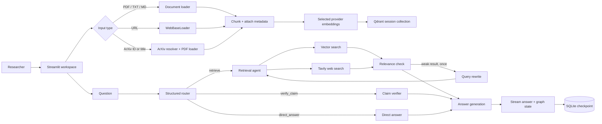

## Architecture

```mermaid
flowchart TB
    subgraph Client[Browser]
        Browser[Streamlit browser client]
    end

    subgraph App[ScholarLens application]
        UI[app.py\nSession UI + upload controls]
        Session[sessions.json\nSession metadata]
        Graph[LangGraph compiled graph]
        Checkpoint[checkpoints.db\nSqliteSaver]
    end

    subgraph Loaders[Ingestion layer]
        PDF[PyMuPDFLoader]
        TXT[TextLoader]
        HTML[WebBaseLoader]
        ARX[ArXiv Atom API + PDF]
        Split[RecursiveCharacterTextSplitter\n1,000 chars / 200 overlap]
    end

    subgraph Retrieval[Retrieval layer]
        Embed[Ollama or OpenAI embeddings]
        Cache[LocalFileStore embedding cache]
        Qdrant[Qdrant Cloud or server]
    end

    subgraph Models[Reasoning layer]
        Models[ChatOllama or ChatOpenAI\nLLM_PROVIDER]
        Tavily[Tavily API]
        Structured[Pydantic structured outputs]
    end

    Browser <--> UI
    UI <--> Session
    UI --> Graph
    Graph <--> Checkpoint
    PDF --> Split
    TXT --> Split
    HTML --> Split
    ARX --> Split
    Split --> Embed
    Embed <--> Cache
    Embed --> Qdrant
    Graph --> Qdrant
    Graph --> Models
    Graph --> Tavily
    Models --> Structured
```

### Component responsibilities

| Component | Responsibility | Important boundary |
|---|---|---|
| `app.py` | Streamlit layout, session bootstrap, uploads, chat streaming, graph-state display | UI orchestration only; business logic lives in backend modules |
| `backend/paper_loader.py` | Load PDF, text, Markdown, web, and ArXiv sources | Produces LangChain `Document` objects with titles and source metadata |
| `backend/vector_store.py` | Create session collections, embed documents, list titles, search | Every collection is derived from a session ID |
| `backend/rag_graph.py` | Router, retrieval tools, relevance loop, verification, answer generation | All turns are represented as typed graph state |
| `backend/models.py` | Pydantic contracts for routes, relevance, and verification | Constrains model decisions to machine-readable shapes |
| `backend/btw_handler.py` | Unpersisted general/current web side channel | Never reads or mutates the vector store |
| `evaluate.py` | Load goldens, run graph queries, calculate DeepEval metrics | Uses a separate evaluation checkpoint database |
| `sessions.json` | Human-readable session names and creation timestamps | Pairs with SQLite checkpoints for complete conversation state |
| `checkpoints.db` | LangGraph state history keyed by `thread_id` | Must be protected as local application state |

## LangGraph state machine

The graph is compiled by `build_graph()` with a SQLite checkpointer. The `RAGState` extends `MessagesState` with routing, retrieval, verification, and retry fields.

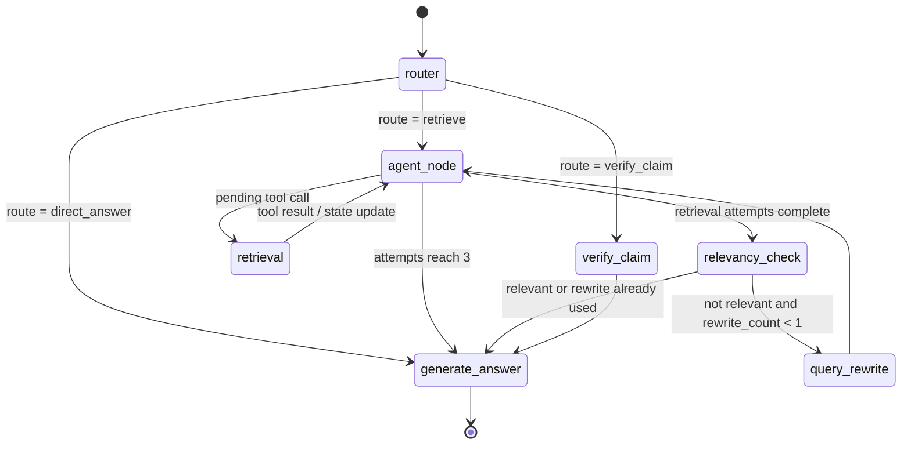

### State fields

| Field | Meaning |
|---|---|
| `messages` | Human, AI, and tool messages managed by `MessagesState` |
| `session_id` | UUID used to isolate the Qdrant collection and checkpoint thread |
| `query` | Current query, possibly replaced by a rewritten query |
| `route` | `retrieve`, `verify_claim`, or `direct_answer` |
| `retrieved_docs` | Accumulated LangChain documents from vector or web retrieval |
| `retrieval_attempts` | Number of retrieval-agent tool-call cycles, capped at three |
| `claim_verdict` | Structured verification summary |
| `claim_source` | First selected superseding source URL, if one exists |
| `superseding_papers` | Up to three title, URL, and summary records |
| `answer` | Final rendered answer |
| `is_relevant` | LLM relevance decision for retrieved snippets |
| `rewrite_count` | Bounded recovery counter, currently one rewrite maximum |

## Detailed request paths

### Paper Q&A sequence

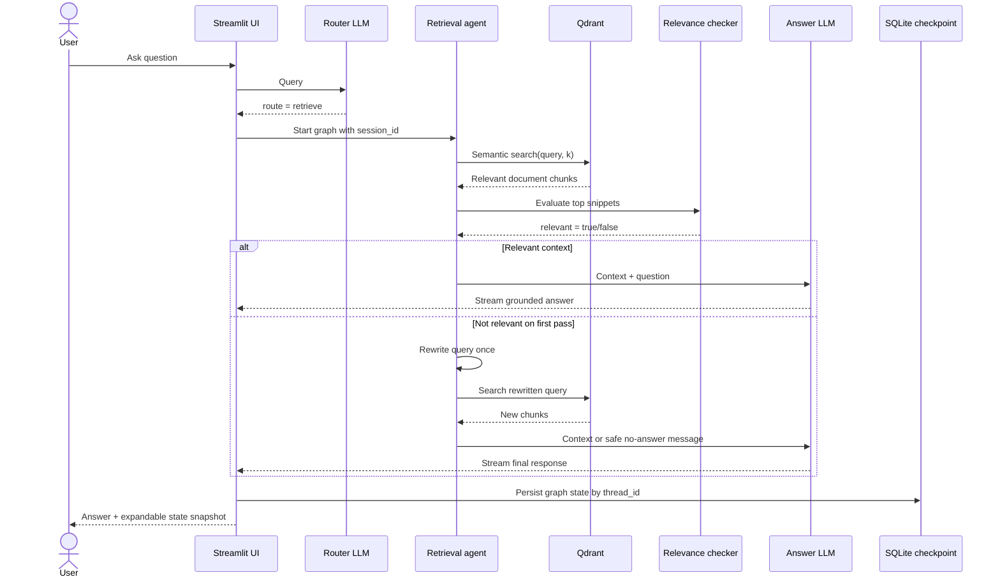

### Claim verification sequence

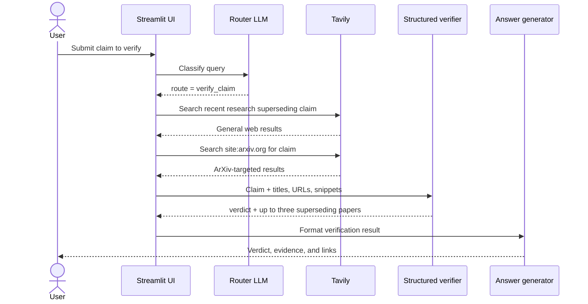

### `/btw` side-channel sequence

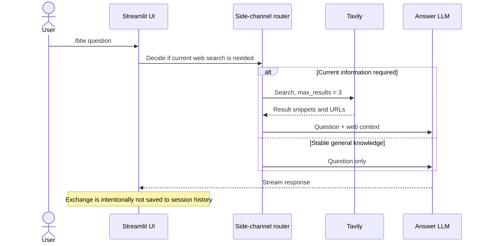

## Ingestion and retrieval internals

### Supported sources

| Source | Input | Loader path | Metadata behavior |
|---|---|---|---|
| PDF | Local `.pdf` | `PyMuPDFLoader` | Title defaults to filename stem; page metadata is retained |
| Plain text | Local `.txt` | `TextLoader` | Title defaults to filename stem |
| Markdown | Local `.md` / `.markdown` | Markdown-aware splitter | Title defaults to filename stem |
| Web page | `http://` or `https://` URL | `WebBaseLoader` | Title uses page metadata or URL |
| ArXiv | ID such as `1706.03762` or title | Atom lookup, then PDF download | Title is extracted from PDF or Atom metadata |

All loaders produce `Document` objects. Documents are split into chunks of 1,000 characters with 200-character overlap, and each chunk carries a title plus loader-specific metadata. Markdown uses a language-aware splitter to preserve structure more effectively.

### Session-scoped vector collections

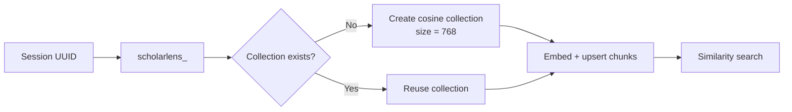

The vector store uses Ollama's `nomic-embed-text`, a 768-dimensional vector configuration, cosine distance, and a local `CacheBackedEmbeddings` store under `embedding_cache/`. Qdrant is configured through `QDRANT_URL` and `QDRANT_API_KEY`.

## Routing behavior

The router returns a Pydantic `RouterDecision` with exactly one route:

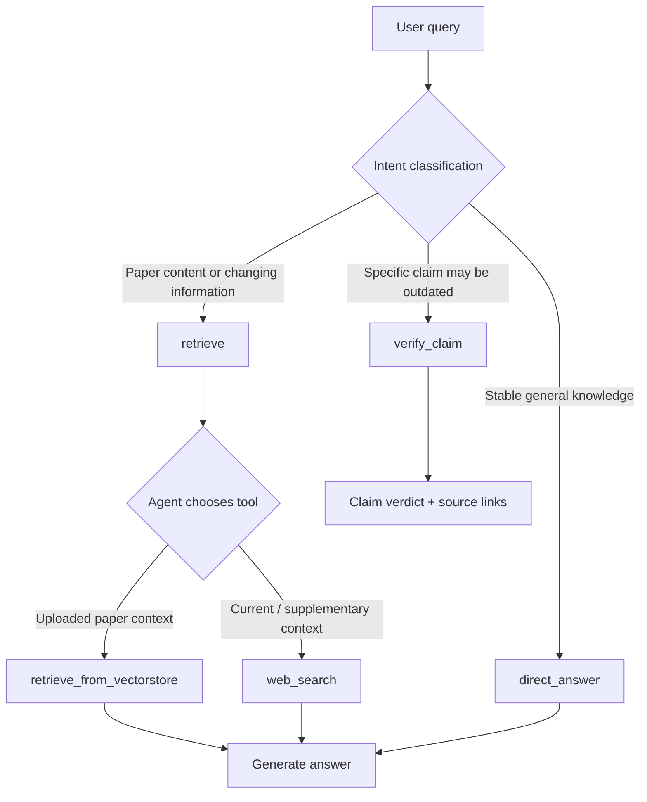

When routing is ambiguous, the system prompt explicitly prefers retrieval over a direct answer. This biases the system toward collecting evidence when a question might depend on the uploaded paper or live information.

## Claim verification behavior

Claim verification is intentionally separate from ordinary retrieval. It performs two Tavily searches:

1. A general search for recent work that supersedes the claim.
2. An ArXiv-targeted search using `site:arxiv.org`.

The verifier is given only the collected titles, URLs, and snippets. Its structured contract requires:

- `is_superseded`
- a one-to-two sentence `verdict_summary`
- zero to three `superseding_papers`
- a summary and URL for every selected paper

The application then formats the verdict and links in the answer. The verifier is instructed to use only titles and URLs present in the search results, which reduces unsupported citation fabrication.

## Persistence and session model

ScholarLens has two persistence layers:

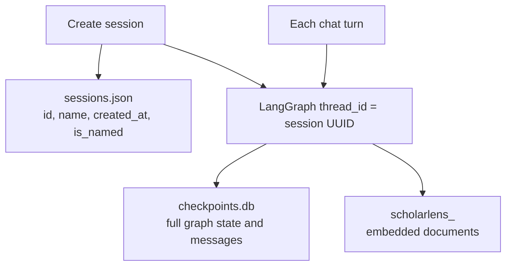

- `sessions.json` stores lightweight sidebar metadata and is used to restore the latest session on startup.
- `checkpoints.db` stores graph state through `SqliteSaver`; it is the source used to reconstruct prior chat messages.
- Qdrant stores the embedded document chunks for each session.
- `/btw` messages are rendered directly and never enter the session graph.

## Evaluation

I evaluate ScholarLens with [DeepEval](https://docs.confident-ai.com/), an LLM evaluation library for retrieval and generation systems. The checked-in [`goldens.json`](goldens.json) contains ten research questions and reference answers derived from `documents/Openclaw_Research_Report.pdf`; [`eval_results.json`](eval_results.json) preserves the per-case generated answer, pass status, score, and evaluator rationale.

### Evaluation pipeline

1. `evaluate.py` loads the saved goldens. When no goldens file exists, DeepEval's `Synthesizer` creates up to two goldens for each of five document contexts and writes question/reference pairs to `goldens.json`.
2. The report is loaded with the same PDF loader and chunking configuration used by ScholarLens.
3. Each golden receives a fresh `evaluation_session_<uuid>` Qdrant collection, ensuring that one case cannot retrieve another case's context.
4. The production LangGraph workflow answers the golden question with the suffix `as per the report in knowledge base`; the runner retains both the final answer and the retrieved chunks.
5. DeepEval constructs an `LLMTestCase` with the input, expected output, actual output, and retrieval context, then evaluates it concurrently with a maximum of three active scoring tasks and a five-second throttle.
6. The runner writes a fully inspectable JSON record for every case to `eval_results.json`.

The application answer path uses the selected ScholarLens provider, including Ollama. The evaluation synthesizer and LLM-as-a-judge metrics use **GPT-5-mini** through `EVAL_MODEL=gpt-5-mini`, keeping judgment consistent while allowing the local application to run end to end on Ollama.

### DeepEval metrics

| Metric | What DeepEval measures | Stored result |
|---|---|---:|
| Contextual Precision | Whether the most useful retrieved chunks appear before less useful chunks | 0.978 |
| Contextual Recall | Whether the retrieved context contains the facts needed by the reference answer | 1.000 |
| Contextual Relevancy | How much of the retrieved context directly addresses the question | 0.576 |
| Answer Relevancy | Whether the final response directly answers the prompt | 0.991 |
| Faithfulness | Whether the final response is supported by its retrieved context | 0.981 |

All metrics use the repository threshold of `0.70`. The saved results show ten of ten cases passing Contextual Precision, Contextual Recall, Answer Relevancy, and Faithfulness; five of ten pass Contextual Relevancy. Five complete cases have every configured metric pass. The result record gives a concrete retrieval optimization target: improve chunk ranking and filtering so the evidence set is more concentrated on the question while retaining the current coverage and grounded-answer quality.

## Live product evidence

I ran ScholarLens end to end with Ollama `qwen3:8b`, `nomic-embed-text`, Qdrant, and Tavily configured in the local environment. I loaded the included research report, asked a paper-grounded security question, and inspected the persisted conversation and graph output.

**Walkthrough:** [Download the ScholarLens feature walkthrough](docs/assets/video/scholarlens-walkthrough.mp4)

| Workspace | Evidence |
|---|---|
| New research workspace | 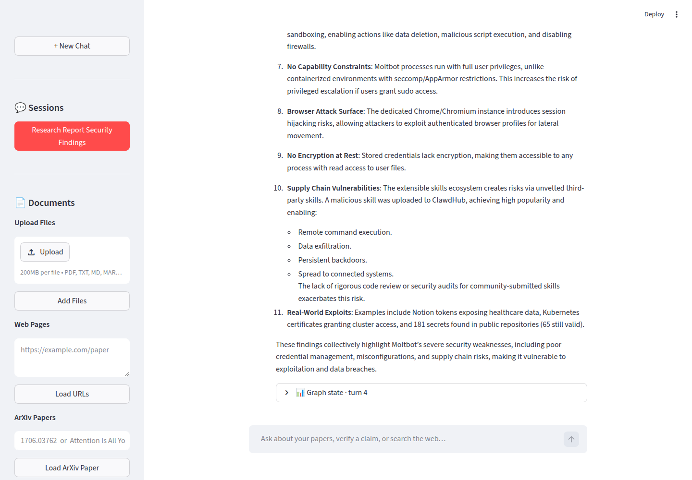 |
| Completed report ingestion | 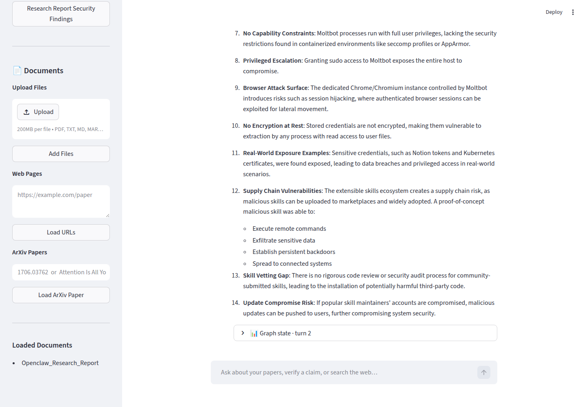 |
| Grounded answer from the OpenClaw report |  |
| Completed graph-state inspection | 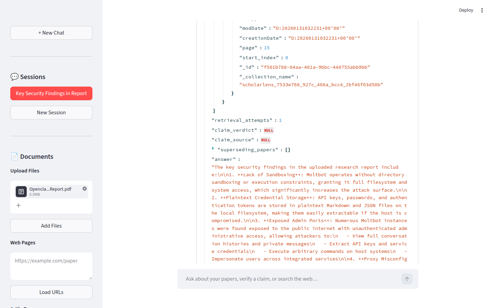 |
| Completed webpage ingestion | 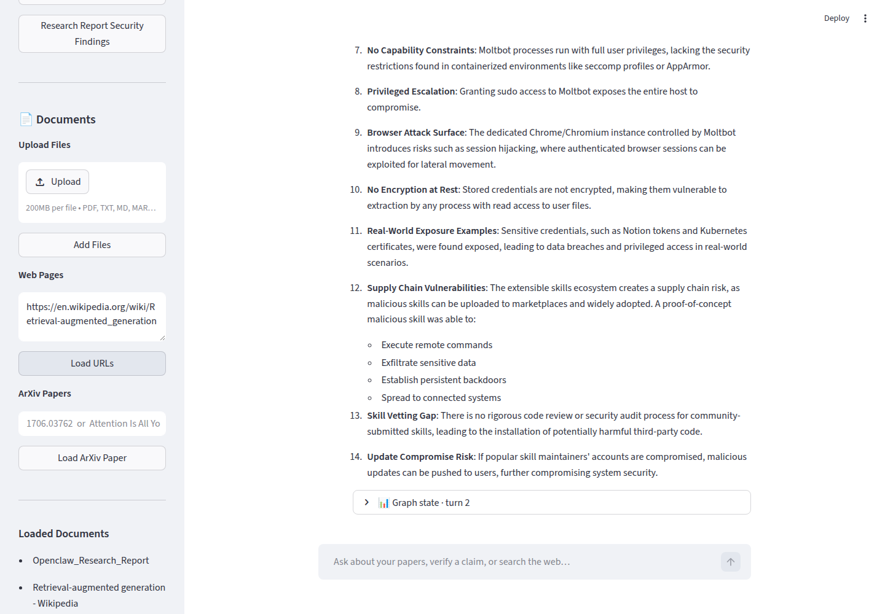 |
| Completed ArXiv ingestion | 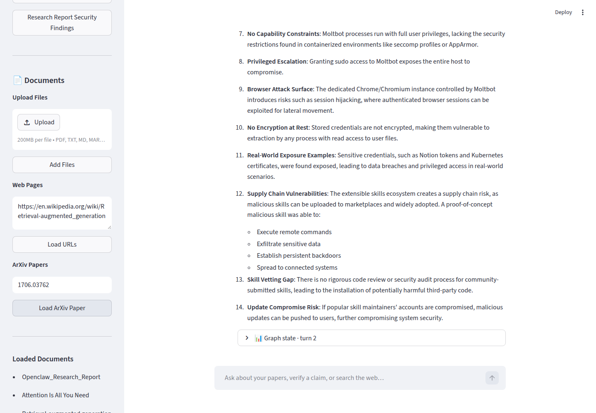 |

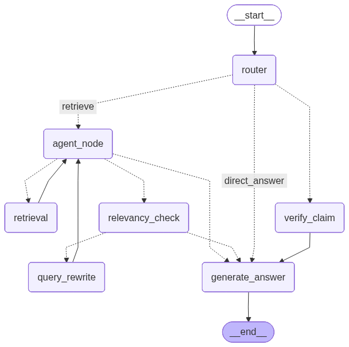

### End-to-end route evidence

I ran the following checks with `LLM_PROVIDER=ollama`, `qwen3:8b`, `nomic-embed-text`, the configured Qdrant Cloud URL and API key, and Tavily.

| Flow | Live input | Observed graph result |
|---|---|---|
| Document retrieval | Security question against `Openclaw_Research_Report.pdf` | Retrieved five Qdrant chunks, passed relevance checking, and generated a source-grounded answer. |
| Direct answer | `What is cosine similarity?` | Router selected `direct_answer`; Ollama returned a concise explanation without retrieval. |
| Current web research | `What is the latest news about OpenAI today?` | Router selected `retrieve`; the agent used the Tavily web-search tool, stored five web documents, and generated a current answer. |
| `/btw` direct side channel | `/btw What is cosine similarity?` | Structured side-channel routing selected general knowledge and streamed an Ollama response outside saved chat history. |
| `/btw` web side channel | `/btw What is the latest news about OpenAI today?` | Structured side-channel routing selected Tavily, then streamed an answer grounded in current web results. |
| Claim verification | Transformer-dominance claim | Router selected `verify_claim`; Tavily general and arXiv searches produced a verdict and three linked, newer papers. |
| Relevance and rewrite recovery | Out-of-domain Mars-terraformation question | Retrieval failed the relevance gate, ran one query rewrite, and returned the bounded no-evidence response. |

## Model providers

ScholarLens supports both **Ollama** and **OpenAI**. Set `LLM_PROVIDER` once and the same provider is used for routing, retrieval-tool decisions, relevance checks, query rewriting, claim verification, answer generation, session naming, `/btw`, and DeepEval metrics. The selected provider also supplies embeddings, so each session collection has a dimension that matches its embedding model.

| Provider | Chat model default | Embedding model default | Best fit |
|---|---|---|---|
| `ollama` | `qwen3:8b` | `nomic-embed-text` | Local inference, private development, and Docker-first operation |
| `openai` | `gpt-4o-mini` | `text-embedding-3-small` | Hosted inference when an OpenAI API key is available |

### Verified local Ollama option

I use the currently installed `qwen3:8b` as the default local chat model. Ollama reports it as a 5.2 GB Q4_K_M model with a 40,960-token context window and native `tools` capability. It fits a roughly 7 GB VRAM budget and calls ScholarLens retrieval tools.

For machines with a tighter memory budget, `qwen3:4b-instruct-2507-q4_K_M` is also installed at 2.5 GB. Use the 8B model when possible for stronger routing and structured-output reliability.

## Quick start

### Prerequisites

- Python 3.12 or newer
- A Qdrant instance (Qdrant Cloud or self-hosted)
- Either a running Ollama service with the configured chat and embedding models, or an OpenAI API key
- A Tavily API key for current web search and claim verification
- Network access to the selected model provider, Tavily, Qdrant, and any ArXiv downloads you use

### 1. Create an environment

```bash
python3.12 -m venv .venv
source .venv/bin/activate
python -m pip install --upgrade pip
pip install -r requirements.txt
```

Docker Compose is the recommended path because it starts ScholarLens, Ollama, and Qdrant together. For local development, the pinned `requirements.txt` installation above is the source of truth.

### 2. Configure secrets

Create `.env` in the project root. Never commit it.

```dotenv
LLM_PROVIDER=ollama
OLLAMA_BASE_URL=http://localhost:11434
OLLAMA_MODEL=qwen3:8b
OLLAMA_EMBEDDING_MODEL=nomic-embed-text
OLLAMA_EMBEDDING_DIM=768
TAVILY_API_KEY=replace_with_tavily_key
QDRANT_URL=http://localhost:6333
QDRANT_API_KEY=
```

To use OpenAI instead, set:

```dotenv
LLM_PROVIDER=openai
OPENAI_API_KEY=replace_with_openai_key
OPENAI_MODEL=gpt-4o-mini
OPENAI_EMBEDDING_MODEL=text-embedding-3-small
OPENAI_EMBEDDING_DIM=1536
```

### 3. Start ScholarLens

```bash
streamlit run app.py
```

Open `http://localhost:8501`.

### 4. Load a paper

Use the sidebar to upload a PDF, TXT, or Markdown file. For the included sample report, select:

```text
documents/Openclaw_Research_Report.pdf
```

Click **Add Files**, wait for the success message, and confirm the title appears under **Loaded Documents**.

### 5. Ask a question

Try:

```text
Which LLM backends does Moltbot support, and how can users select them?
```

The graph will route the question, retrieve chunks, check relevance, generate an answer, and expose the final state under the expandable graph-state panel.

## Docker deployment

The included Compose stack starts the Streamlit app, Ollama, model initialization, and Qdrant together. It is the recommended deployment path.

```bash
cp .env.example .env
docker compose up --build
```

Open `http://localhost:8501` or follow the longer [`DOCKER_GUIDE.md`](DOCKER_GUIDE.md) for model settings and EC2 deployment.

### Container assumptions

- Port `8501` is the Streamlit HTTP port.
- Environment variables provide all provider credentials.
- Compose runs Qdrant as a named-volume-backed service.
- Compose mounts durable volumes for session checkpoints and the embedding cache.
- The current image copies `documents/`, including the sample PDF. Review data-handling requirements before shipping private documents in an image.

## Qdrant setup

For Qdrant Cloud, create a cluster, copy its endpoint and API key, and put them in `.env`. The application creates one collection per session when the first document is added or the first vector search is attempted.

Collection names follow:

```text
scholarlens_<session_uuid_with_hyphens_replaced_by_underscores>
```

The configured vector size must match the selected embedding provider: `OLLAMA_EMBEDDING_DIM = 768` for the default `nomic-embed-text`, or `OPENAI_EMBEDDING_DIM = 1536` for the default `text-embedding-3-small`. Changing provider, embedding model, or dimension requires creating fresh Qdrant collections.

## Configuration reference

| Variable | Required | Used by | Purpose |
|---|---:|---|---|
| `LLM_PROVIDER` | Yes | `backend/llm.py` | Select `ollama` or `openai` for every chat and embedding operation |
| `OLLAMA_BASE_URL` | When using Ollama | `ChatOllama`, `OllamaEmbeddings` | Ollama service endpoint |
| `OLLAMA_MODEL` | When using Ollama | `ChatOllama` | Chat model used for routing, answering, naming, and verification |
| `OLLAMA_EMBEDDING_MODEL` | When using Ollama | `OllamaEmbeddings` | Local embedding model |
| `OLLAMA_EMBEDDING_DIM` | When using Ollama | `vector_store.py` | Qdrant vector dimension for the Ollama embedding model |
| `OPENAI_API_KEY` | When using OpenAI | `ChatOpenAI`, `OpenAIEmbeddings` | OpenAI API authentication |
| `OPENAI_MODEL` | When using OpenAI | `ChatOpenAI` | Hosted chat model |
| `OPENAI_EMBEDDING_MODEL` | When using OpenAI | `OpenAIEmbeddings` | Hosted embedding model |
| `OPENAI_EMBEDDING_DIM` | When using OpenAI | `vector_store.py` | Qdrant vector dimension for the OpenAI embedding model |
| `EVAL_MODEL` | For evaluation | `evaluate.py` | GPT-5-mini model used for DeepEval synthesis and judging |
| `TAVILY_API_KEY` | For live search | `rag_graph.py`, `btw_handler.py` | Web search and claim verification |
| `QDRANT_URL` | Yes | `vector_store.py` | Vector database endpoint |
| `QDRANT_API_KEY` | For Qdrant Cloud | `vector_store.py` | Vector database authentication |

Model names are currently defined in code:

- `LLM_PROVIDER=ollama`: `OLLAMA_MODEL` defaults to `qwen3:8b`; embeddings default to `nomic-embed-text`.
- `LLM_PROVIDER=openai`: `OPENAI_MODEL` defaults to `gpt-4o-mini`; embeddings default to `text-embedding-3-small`.

Changing models should be accompanied by evaluation and, for embedding changes, a complete vector-store rebuild.

## Security and privacy

### Current protections

- Secrets are read from environment variables via `python-dotenv`.
- Session collections are separated by UUID-derived names.
- `/btw` avoids writing quick questions into the research graph.
- Claim verification constrains selected titles and URLs to search-result evidence.
- Retrieval attempts and rewrites are bounded to avoid unbounded agent loops.
- The UI shows an explicit graph-state snapshot rather than silently hiding retrieval behavior.

## Failure modes and troubleshooting

| Symptom | Likely cause | Action |
|---|---|---|
| Ollama connection error | Ollama is not running, the model is not pulled, or the URL is wrong | Start the Compose stack, check `docker compose logs ollama`, and verify `OLLAMA_BASE_URL` |
| Qdrant connection error | Incorrect URL, key, TLS, or network route | Test the endpoint, confirm port 6333, and review Qdrant Cloud credentials |
| `TAVILY_API_KEY` error | Live-search path invoked without Tavily credentials | Add the key or use a paper/direct-answer query |
| Upload succeeds but no titles appear | Collection creation or Qdrant write failed | Inspect terminal logs and verify Qdrant permissions |
| Answer says no relevant information | Retrieval and one rewrite did not pass relevance | Rephrase the question, upload more context, or ask about terminology used in the paper |
| ArXiv title search fails | ArXiv API did not return a matching title | Use the paper's numeric ArXiv ID |
| Old sessions do not load | Missing `checkpoints.db` or changed working directory | Start Streamlit from the project root and preserve the database file |
| Container loses history | State was written inside an ephemeral container | Mount persistent storage for SQLite and local cache, and retain Qdrant collections |
| `/btw` answer is not in chat history | This is intentional | Use a normal chat prompt when persistence is required |

## Project layout

```text
.
├── app.py                         # Streamlit UI and interaction orchestration
├── evaluate.py                    # DeepEval evaluation runner
├── main.py                        # Minimal package entry point
├── pyproject.toml                 # Project metadata and dependency declarations
├── requirements.txt               # Fully pinned environment requirements
├── uv.lock                        # uv lockfile
├── Dockerfile                     # Container image definition
├── DOCKER_GUIDE.md                # Docker Hub and EC2 deployment guide
├── qdrant_login_steps.md          # Qdrant Cloud credential setup
├── backend/
│   ├── btw_handler.py             # Unpersisted side-channel web/general Q&A
│   ├── models.py                  # Pydantic routing and verification contracts
│   ├── paper_loader.py            # PDF, text, Markdown, web, and ArXiv loaders
│   ├── rag_graph.py               # LangGraph state machine and tools
│   └── vector_store.py            # Embeddings, Qdrant collections, and search
├── documents/
│   └── Openclaw_Research_Report.pdf # Included sample research report
├── graph.png                      # Existing generated graph visualization
├── goldens.json                   # DeepEval generated questions and references
├── eval_results.json              # Stored evaluation outputs
└── sessions.json                  # Session sidebar metadata
```

Runtime-generated files that should remain local include `.env`, `checkpoints.db`, `eval_checkpoints.db`, `embedding_cache/`, and `.deepeval/`.

## Operational runbook

### Starting a fresh deployment

1. Provision Qdrant.
2. Create provider keys with the minimum required scopes.
3. Add environment variables through the deployment secret manager.
4. Start the container or Streamlit process.
5. Load a non-sensitive test paper.
6. Verify a paper question, a claim-verification prompt, and a `/btw` prompt.
7. Confirm the graph-state snapshot contains expected route and retrieval fields.
8. Record baseline evaluation metrics before loading production material.

### Rotating credentials

Rotate Tavily and Qdrant keys in the deployment secret manager, restart the process, and delete old keys at the provider. Ollama model access is controlled by the Ollama host and network boundary. Do not rewrite credentials into source files or screenshots.

### Backing up state

Back up Qdrant collections according to the Qdrant deployment model. Back up `checkpoints.db` and `sessions.json` only if session continuity is required. Back up `embedding_cache/` for performance, not as the source of truth; embeddings can be regenerated from documents.

## Design decisions

### Why explicit routing?

Retrieval and direct answers have different evidence requirements. Explicit routing makes those requirements visible and allows claim verification to use a dedicated evidence path.

### Why a relevance gate?

Similarity search always returns something when asked. The relevance check gives the graph a chance to reject clearly off-topic chunks and try a rewritten query before generating an answer.

### Why cap retrieval attempts?

Agent loops can become expensive and can leave malformed tool-call history in a persisted graph. The graph caps tool-call cycles at three and switches to a tool-free model call at the cap.

### Why use SQLite checkpoints?

The checkpointer gives each session a durable, inspectable graph thread without introducing another service. It is suitable for a local or single-process deployment; a multi-user service should move to a managed, access-controlled persistence layer.

### Why keep `/btw` separate?

Not every question belongs in the research notebook. The side channel supports quick context gathering while preserving the semantic distinction between durable research and ephemeral assistance.

## Reproducing evaluation

```bash
source .venv/bin/activate
python evaluate.py
```

This command calls Ollama, Tavily, Qdrant, and DeepEval integrations. Tavily usage may incur costs. Use a dedicated evaluation Qdrant namespace and review generated artifacts before committing them.

## License

No license file is currently included. Add a license before distributing the project publicly.

## Acknowledgements

ScholarLens is built with Streamlit, LangChain, LangGraph, Qdrant, Ollama, Tavily, PyMuPDF, ArXiv's public API, and DeepEval.

---

<div align="center">

**Research with evidence. Reason with state. Keep the path inspectable.**

</div>
